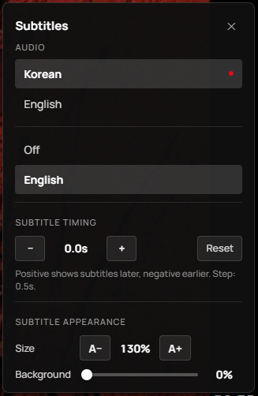

# TODO

- [ ] never show downlaods when starting a dowload, unless clicked 
  *not done: queueing still calls openDownloads() (public/app.js:4013, 4144, 4981)*
- [ ] in idle screen add logo of the movie
  *not done: the pause screen draws the N badge + backdrop, no title logo (public/watch.html:135)*
- [x] add player drag preview frames
  *done: sprite grid loads on the first timeline hover (public/watch.js:1079, server/frames.js)*
- [x] fix delete videos not wokring inside the website.
  *done: the server closes its own streams, then retries the unlink (server/index.js:1024)*
- [x] anything that's downloaded, should be added to the database, only keep the videos outside (same as before in folder) and save their path inthe database for each
  *done: the rescan after a job upserts the file and its rel_path into items (server/library.js:441)*
- [x] add delete all button close to doanload all button
  *done: #castleSeasonDelete sits right next to #castleSeasonDownload (public/index.html:374)*
- [ ] when an episode is deleted, keep progress viewed, dont remove it, but update the button from"play" to "download" 
  *not done: progress is keyed by the local item id and rows only paint for files on disk (public/app.js:3896)*
- [ ] In catalogue , only show " > resume" no season or episode
  *not done: the sheet button still reads "Resume S02E05" / "Download Season 2" (public/app.js:4304)*
- [x] Fix video prioritizing + seeds etc (best score)
  *done: one deterministic score per release, the healthier swarm wins (server/torrentio.js:347)*
- [x] The download speed is very low, forget format, as long as it's 1080p or above then download it, priority are for those who have higher seed etc + low size at the same time
  *done: 1080p/2160p only, seeders x10 capped at 700, then size bands (server/torrentio.js:333)*
- [x]  the default for all players should be original dub, always! unless the user changed it in that serie!
  *done: track 1 is the original dub, and a choice saved for the series wins (public/watch.js:808)*
