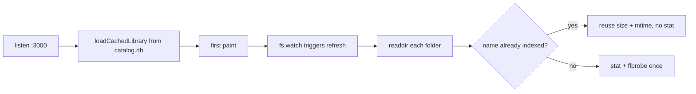
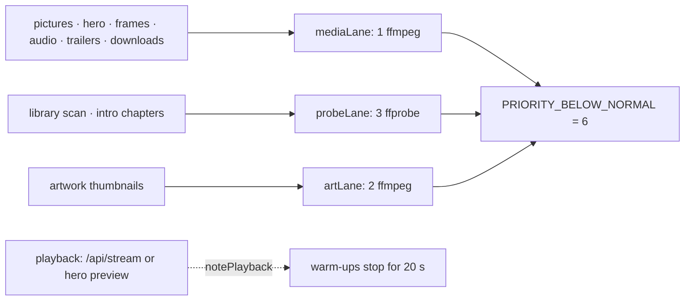

# Optimising netflix-home — what was done

A record of the performance work on the local Netflix-style player in this repo:
what changed, why, how it was measured, and what is still open.

Scope: launch speed, idle CPU/GPU cost, bytes on the wire, and background media
work. Behaviour of the UI (nav, playback, downloads) was not changed.

Everything below was verified against the running app, not assumed.

---

## 1. Starting point

Before this pass the app had three costs that made it feel heavy:

| Problem | Effect |
| --- | --- |
| Every launch walked and `stat`ed the whole library | seconds of disk work before the first paint on a cold drive |
| A rescan always produced a new `updatedAt` | browsers re-downloaded the whole `/api/library` JSON instead of a `304` |
| ffmpeg/ffprobe ran at normal priority, several at once | scrolling stuttered while a hero clip or thumbnail was being built |

Metadata also lived in several SQLite files (`library.db`, `pictures.db`,
`trailers.db`) plus JSON sidecars, which meant several opens, several WALs, and
partial states after a crash.

---

## 2. One database

**Decision:** a single `G:\NETFLIX\.cache\catalog.db` owns all metadata. Large
media stays on disk with an indexed path; artwork, subtitles and probes are rows.

Schema now covers `items`, `assets`, `subtitles`, `audio_probe`, `audio_tracks`,
`picture`, `hero`, `trailers`, `intro`, `dirs`, `scan_state`, `kv`.

- Legacy files were migrated once and then removed from `.cache`
  (`library.db`, `pictures.db`, `trailers.db`, `meta.json`, `intro.json`,
  `thumbs\`).
- `initDb(cacheDir)` creates `.cache` itself. Before this, a first run on a blank
  drive silently disabled every cache with *“catalog database disabled: unable
  to open database file”*.

---

## 3. Launch without a library scan (Phase 1)



- **`dirs` table** stores each folder's listing (name, size, mtime).
- **`walkIndexed()`** always calls `readdir` — directory mtimes on NTFS are
  lazily updated and cannot be trusted — then reuses saved sizes for names that
  still exist and `stat`s only unknown names. No `ffprobe` for unchanged files.
- **Unchanged scans keep `updatedAt`**, so the `/api/library` ETag stays stable
  and clients get `304` with zero bytes.
- **`fs.watch(root, { recursive: true })`** with a 2.5 s debounce drives the same
  `refreshLibrary()` path as the manual Rescan button. The watcher ignores
  `.cache`, `*.part`, `*.log` and `netflix-home.exe`, and is muted during scans,
  so the app's own database/WAL/log writes cannot cause a scan loop.
- `/api/library` and `/api/db/stats` report the scan shape:
  `{ ms, files, dirs, reusedDirs, readDirs, probed, changed }`.

**Measured:** 26 files in 8 folders, nothing changed → **7–11 ms, 0 stats,
0 ffprobe** (was ~97 ms with 26 stats). A launch on a three-folder library checks
in 21–38 ms.

**Known limit:** a file replaced in place under the same name is not detected at
launch. The watcher catches it while running, and a manual Rescan detects it.

---

## 4. Background media work (Phase 2)

New module `server/proc.js` is now the only way the app starts a media process.



- **Priority.** `os.setPriority(pid, PRIORITY_BELOW_NORMAL)` on every child.
  Windows base priority measured **6** (normal is 8) via `Win32_Process.Priority`.
- **Lanes instead of ad-hoc concurrency.** `mediaLane` admits one heavy job at a
  time, `probeLane` three probes, `artLane` two thumbnails. Callers that cannot
  get in fall back to their normal on-demand path; nothing blocks the player.
- **Playback gate.** `/api/stream` and `/api/hero/:id/preview.mp4` call
  `notePlayback()`; `warmHeroes`, `warmTrailers` and `warmArtwork` return early
  while playback happened in the last 20 s. On-demand builds still run, so
  clicking Play never waits for a warm-up.
- `library.js`, `pictures.js`, `hero.js`, `frames.js`, `audio.js`, `trailers.js`,
  `intro.js` and the HLS remux were all converted; the only raw `execFile` left
  in the tree is inside `proc.js` itself.

**Measured:** synthetic 130 s clip in a temp library — scan 108 ms, only one
ffmpeg alive at a time, hero build produced a 48 KB still + 1.6 MB clip in 3 s,
no stderr.

---

## 5. Fewer bytes (Phase 3)

### 5.1 Gzipped library JSON

The payload is serialised once per revision and gzipped once (level 6), keyed by
ETag + scan fingerprint. `Vary: Accept-Encoding` is set; the ETag and the `304`
path are unchanged.

Measured on one title: **886 B → 502 B**. The ratio improves with size
(a few hundred titles is roughly 400 KB → 60 KB).

### 5.2 Artwork sized to the slot

`/api/art/:id/:kind?w=480` renders a JPEG at the nearest width of the ladder
**160 / 240 / 320 / 480 / 640 / 960 / 1280**, stored once in
`.cache\art\sized\`, from either the cached catalog BLOB or a sidecar picture.

- ffmpeg clamps with `scale='min(iw,W)':-2`, so a small poster is never upscaled.
- Renders go through `artLane` (2 slots) and below-normal priority.
- Logos (transparent PNG) are never resized.
- Frontend plumbing: `thumbUrl(item, width)` and `posterUrl(item, width)`.
  Cards ask 480, grid 640, episode thumbs 320, hero keeps the original size with
  `fetchpriority="high"`, media-session art asks 1280.

Measured with a 1600×900 sidecar backdrop (101,874 B source):

| Request | Bytes | Output |
| --- | --- | --- |
| `?w=240` | 3,796 | 240×136 |
| `?w=480` | 9,722 | 480×270 |
| `?w=960` | 29,460 | 960×540 |

A real Cinemeta poster: first request **824 ms** (download + scale), warm hit
**17 ms**.

### 5.3 Immutable UI assets

- HTML is served `no-cache`, with `/x.css` and `/x.js` rewritten to
  `/x.css?v=<stamp>`.
- JS, CSS, fonts and icons are `public, max-age=31536000, immutable`;
  `startup.mp4` gets one day.
- The stamp is an 8-character hash of the six asset files' size + mtime, so a
  deploy invalidates them without manual version bumps.

---

## 6. Castle download quality (investigation)

The Online provider wraps `api.hlowb.com`. Question asked: **can anything above
1080p be downloaded?**

Method: request the session key, decrypt the AES-CBC responses, then call
`searchByKeyword`, `movie` (detail) and `getVideo2` directly for ~60 titles,
including resolutions 0, 4, 5, 6 and 8.

Result:

| Resolution id | Label | Delivered by `getVideo2` |
| --- | --- | --- |
| 1 | SD 480P | yes |
| 2 | HD 720P | yes |
| 3 | FHD 1080P | **no** — `premiumProPermission: true`, empty `videoUrl` |
| 4+ | — | parameter accepted, never returns a URL |

No catalog entry exposes a 4K/2160p stream. 720p is the real ceiling without a
premium account, so `getCastleStream` keeps its `1..3` whitelist and its `409`
(“1080p is premium-only on this source”) — nothing to enable.

---

## 7. Results at a glance

| Metric | Before | After |
| --- | --- | --- |
| Launch scan, nothing changed | ~97 ms, 26 stats | 7–11 ms, 0 stats |
| First library response | 138 ms (waits for scan) | served from catalog.db at listen |
| Unchanged rescan | new `updatedAt`, full re-download | `304`, 0 bytes |
| Library JSON (1 title) | 886 B | 502 B gzip |
| Card artwork | full-size backdrop | 9.7 KB at 480 px |
| ffmpeg priority | normal (8) | below normal (6) |
| Concurrent heavy ffmpeg | several | 1 |
| UI assets | revalidated every load | immutable, version-stamped |
| Cache files | 3 databases + JSON | 1 `catalog.db` |

Commits: `f49e454` (one DB), `2baeb7b`, `b80f8b6`, `a2485a8`, `0abc4b0`,
`76e84e6` (index-only launch + watcher), `a3c30b8` (priority + lanes),
`e89e99f` (gzip + sized art + immutable assets).

---

## 8. Bugs found and fixed along the way

| Symptom | Cause | Fix |
| --- | --- | --- |
| Scan loop every few seconds | watcher saw `launcher.log` writes in the library root | ignore `*.log` |
| Scan loop after a scan | catalog WAL writes inside the watched root | mute watcher during refresh |
| “catalog database disabled” on a fresh drive | `.cache` did not exist yet | `initDb` creates it |
| Hero/picture builds failed with `Could not open file` | module init bailed when `catalog.db` could not open, so `.cache\hero` and `.cache\pictures` were never created | `initDb` creates `.cache` first, then each module creates its own folder |
| Rebuilding ffmpeg muxer warning | single-image output | explicit `-f image2 -update 1` |

---

## 9. How to check it is still healthy

```powershell
# launch shape, scan timing, 0 probes when nothing changed
Invoke-RestMethod http://localhost:3000/api/library | Select-Object updatedAt,scanning,scan

# row counts and DB size
Invoke-RestMethod http://localhost:3000/api/db/stats | ConvertTo-Json -Depth 2

# gzip + ETag
curl.exe -s -D - -o NUL -H "Accept-Encoding: gzip" http://localhost:3000/api/library

# asset headers
curl.exe -s -D - -o NUL http://localhost:3000/app.js
```

Expected: `scan.probed: 0` and `scan.changed: false` on an unchanged library,
`Content-Encoding: gzip` with the same ETag as the plain response,
`Cache-Control: public, max-age=31536000, immutable` on `/app.js`.

---

## 10. Still open (from `plan.md`)

- **Phase 2 leftovers:** start warm-ups only after the first `/api/library`
  request; cheaper stills (5 samples, 8 s hero clip, `-threads 1`); cancel the
  queue mid-build on playback.
- **Phase 4:** DOM diffing for rows, `content-visibility: auto` on rows,
  `fetchpriority` only on the hero, sprite timeline on hover only, library poll
  from 60 s to 5 min.
- **Phase 5:** `PRAGMA optimize` / `wal_autocheckpoint` tuning, indexes checked
  with `EXPLAIN QUERY PLAN`, orphan-row cleanup.
- **Phase 6:** cheaper boot, one log line per refresh, `cpuUsage` /
  `memoryUsage` in `/api/db/stats`.
- **Harness:** `scripts/bench.mjs` to measure listen time, first library, scan,
  CPU, RSS and page bytes, with regression limits.
